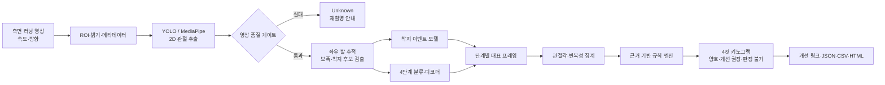

# RunScope 제품 요구사항 문서(PRD)

| 항목 | 내용 |
|---|---|
| 문서 버전 | 1.0 |
| 작성일 | 2026-11-14 |
| 제품 단계 | 개인 프로젝트 · 연구용 오프라인 프로토타입 |
| 제품명 | RunScope |
| 핵심 입력 | 고정된 측면 트레드밀 러닝 영상과 러닝 속도 |
| 핵심 출력 | 보폭별 4단계 장면, 관절선, 단계 인식 결과, 보수적인 자세 피드백 |
| 현재 권장 조건 | 약 8.0–8.5 km/h, 전신 측면, 30 fps 이상, 10–30초 |
| 의료적 지위 | 의료기기 또는 진단 도구가 아님 |

## 문서 목차

1. 제품 정의와 해결하려는 문제
2. 목표 사용자, 입력 조건, 사용자 경험
3. 기능 요구사항과 전체 처리 구조
4. 자세 피드백 규칙과 데이터 전략
5. 모델·실험 이력과 현재 성능
6. 품질 게이트, F1 정책, 안전 요구사항
7. 성공 지표, 출시 조건, 개발 로드맵

---

## 1. 제품 한 문장 설명

RunScope는 사용자가 촬영한 **측면 트레드밀 달리기 영상**에서 사람의 관절을
추적하고 보폭을 자동으로 찾은 뒤, 한 보폭을 `착지 → 제동 → 추진 → 회복`의
네 단계로 나누어 대표 장면과 관절선을 보여주고, 근거가 있는 항목에 한해서만
`양호`, `개선 권장`, `판정 불가` 피드백을 제공하는 러닝 분석 프로토타입이다.

제품의 핵심 가치는 숫자 하나로 사람을 평가하는 것이 아니라 다음 질문에
시각적으로 답하는 데 있다.

> “내가 달리는 한 보폭에서 언제 착지하고, 언제 버티고, 언제 밀어내고,
> 언제 다리를 회수하며, 반복되는 자세 중 확인할 부분은 무엇인가?”

---

## 2. 배경과 해결하려는 문제

### 2.1 사용자 문제

일반 사용자는 러닝머신에서 달리는 자신의 모습을 촬영해도 다음을 직접
판단하기 어렵다.

1. 한 보폭의 시작과 끝이 어디인지 알기 어렵다.
2. 착지, 제동, 추진, 회복의 대표 프레임을 수작업으로 찾기 어렵다.
3. 관절의 움직임을 맨눈으로 일관되게 비교하기 어렵다.
4. 인터넷의 러닝 자세 조언은 개인 영상의 어느 장면에 해당하는지 알기 어렵다.
5. 힘판이나 3D 모션캡처가 없는 실제 사용 환경에서는 정답을 직접 확인할 수 없다.

### 2.2 기술적 문제

- 착지 구간은 약 30 ms로 매우 짧아 30–33 fps 영상에서는 사실상 한 프레임에
  가깝다.
- 트레드밀 프레임, 반대쪽 다리, 배경 사람, 모션 블러가 관절 추적을 방해한다.
- 동일 모델도 속도와 참가자가 바뀌면 성능이 크게 달라질 수 있다.
- 단계 인식 정확도와 좋은/나쁜 러닝 자세 판정은 서로 다른 문제다.
- 실제 사용자 영상에는 힘판 정답이 없으므로 그 영상 하나만으로 F1-score를
  계산할 수 없다.

### 2.3 RunScope의 해결 방식

RunScope는 문제를 한 모델에 억지로 합치지 않고 세 층으로 분리한다.

1. **영상 품질 층:** 분석 가능한 측면 영상인지 먼저 판정한다.
2. **시간 분석 층:** 착지 이벤트와 4단계 구간을 추정한다.
3. **자세 피드백 층:** 단계별 측정값을 여러 보폭에서 집계해 근거가 있는
   항목만 피드백한다.

---

## 3. 제품 비전과 원칙

### 3.1 비전

별도 센서가 없는 개인 러닝 영상도 실험실 분석처럼 이해하기 쉬운 4단계
키노그램으로 바꾸되, 모델이 모르는 것은 솔직하게 `판정 불가`라고 표시한다.

### 3.2 제품 원칙

1. **정답 없는 영상에 가짜 F1을 만들지 않는다.**
2. **단일 프레임보다 반복 보폭을 우선한다.**
3. **품질이 나쁘면 관절선과 자세 판정을 숨긴다.**
4. **단계 인식과 자세 품질을 구분한다.**
5. **참가자 기준으로 train/validation/test를 분리한다.**
6. **test 영상으로 재학습하거나 임계값을 바꾸지 않는다.**
7. **기존 모델과 결과를 덮어쓰지 않고 버전별로 보존한다.**
8. **의학적 진단, 부상 예측, 치료 결정을 하지 않는다.**

---

## 4. 목표와 비목표

### 4.1 현재 제품 목표

- 측면 트레드밀 영상에서 주자를 추적한다.
- 자동으로 보폭과 착지 후보를 찾는다.
- 보폭을 Landing, Braking, Propulsion, Recovery로 나눈다.
- 각 단계의 대표 프레임을 한 화면에 출력한다.
- 추적한 주자의 관절선을 정확한 다리에 표시한다.
- 여러 보폭의 중앙값과 반복성을 바탕으로 자세를 스크리닝한다.
- 개선 권장 항목에는 검토된 교육 영상 링크를 제공한다.
- 분석 불가 영상에는 그럴듯한 오답 대신 `Unknown`을 출력한다.

### 4.2 현재 비목표

- 실시간 러닝 코칭
- 의료 진단이나 부상 위험 확률 제공
- 통증의 원인 판정
- 모든 속도와 모든 카메라 각도 지원
- 전후면 영상에서 무릎 외반, 골반 하강, 발뒤꿈치 외번 판정
- 힘판 없는 사용자 영상에서 새로운 F1-score 계산
- 모든 사람에게 동일한 케이던스 또는 보폭 강요
- 전문가 확인 없이 공개데이터의 건강인·선수·착지 유형을 Good/Bad 정답으로 사용

---

## 5. 목표 사용자와 사용 시나리오

### 5.1 1차 사용자

개인 러닝 프로젝트를 진행하며 자신의 트레드밀 자세를 영상으로 확인하려는
비전문 사용자다.

**사용자 목표**

- 내 보폭의 네 단계를 사진으로 보고 싶다.
- 관절선이 실제 몸에 맞게 붙었는지 확인하고 싶다.
- 반복적으로 나타나는 개선 후보를 알고 싶다.
- 나쁜 촬영이나 모델 오류를 좋은 결과로 오해하고 싶지 않다.

### 5.2 2차 사용자

러닝 영상 분석 모델을 비교하고 재현하려는 개발자 또는 연구자다.

**사용자 목표**

- 데이터 분할과 모델 동결 상태를 확인하고 싶다.
- 각 실험의 입력, 아티팩트, 해시, 평가 결과를 재현하고 싶다.
- 단계 F1, 이벤트 F1, 자세 피드백을 구분해 해석하고 싶다.

### 5.3 대표 사용 시나리오

1. 사용자가 러닝머신을 8.1 km/h로 설정한다.
2. 스마트폰을 진행 방향과 직각인 측면에 고정한다.
3. 전신이 보이도록 일정 속도로 10–30초 달린다.
4. 영상과 속도, 진행 방향을 RunScope에 입력한다.
5. RunScope가 품질을 확인하고 유효 보폭을 검출한다.
6. 사용자에게 네 단계 대표 장면과 집계된 자세 피드백을 보여준다.
7. 개선 권장 항목이 있으면 근거와 검토된 교육 링크를 제공한다.

---

## 6. 입력 요구사항

### 6.1 필수 입력

| 입력 | 요구사항 |
|---|---|
| 영상 | 편집하지 않은 MP4 또는 MOV 권장 |
| 촬영 방향 | 주자의 정확한 측면, 진행 방향과 카메라가 직각 |
| 프레임레이트 | 최소 30 fps, 권장 60 fps |
| 영상 길이 | 최소 10초, 권장 20–30초 |
| 신체 범위 | 머리부터 양발 끝까지 화면 안에 포함 |
| 속도 | 러닝머신 표시 속도와 단위 입력 |
| 진행 방향 | 화면 기준 왼쪽 또는 오른쪽 입력 |

### 6.2 현재 권장 속도

- 1차 권장: **8.0–8.5 km/h**
- 현재 대표 검증 속도: **8.1 km/h = 2.25 m/s**
- 기존 관절각 기준선의 학습 지원 범위: 약 1.8–2.4 m/s
- 9.9 km/h 영상에서는 동일 4단계 방법의 성능 감소가 확인됐으므로 실험 결과로
  표시해야 한다.

### 6.3 촬영 실패 조건

- 난간이나 장비가 무릎·발목·발을 지속해서 가림
- 배경 사람이 주자와 겹침
- 정면 또는 사선 각도가 큼
- 화면이 흔들리거나 주자가 프레임 밖으로 나감
- 속도 변화, 시작, 정지 구간만 존재
- 유효 보폭이 5개 미만

---

## 7. 사용자 경험과 결과 화면

### 7.1 기본 결과 화면

사용자에게 한 대표 보폭의 4단계 카드를 가로로 보여준다.

| 단계 | 사용자 표현 | 내부 의미 | 대표 장면 선택 |
|---:|---|---|---|
| 1 | Landing · 착지 | Initial Contact 직후의 짧은 착지 구간 | 착지 단계 중앙 또는 검출 접촉 프레임 |
| 2 | Braking · 제동 | 착지 후 몸이 하중을 받아들이는 구간 | 보폭 내 최대 stance knee flexion |
| 3 | Propulsion · 추진 | 전방 추진 후 Toe-off까지 | 추진 말기 또는 TO 직전 |
| 4 | Recovery · 회복 | Toe-off부터 다음 같은 발 착지까지 | 회복 단계 중앙 또는 최대 swing knee flexion |

### 7.2 색상 의미

| 색상 | 상태 | 의미 |
|---|---|---|
| 초록 | `GOOD / 양호` | 선택한 스크리닝 기준을 반복 보폭에서 충족 |
| 빨강 | `IMPROVE / 개선 권장` | 반복적으로 기준을 벗어나 재확인 또는 연습 권장 |
| 회색 | `UNKNOWN / 판정 불가` | 근거, 영상 품질 또는 적용 가능한 규칙 부족 |

빨강은 의료적 `Bad`를 뜻하지 않는다. 사용자의 행동을 안내하기 위한 보수적
제품 상태명은 `개선 권장`으로 고정한다.

### 7.3 반드시 함께 표시할 정보

- 사용한 보폭 수
- 대표 프레임의 관절 측정값
- 전체 보폭 중앙값과 IQR 또는 일관성
- 4단계 인식 F1과 자세 F1의 구분 문구
- 자세 정답이 없으면 `자세 F1 없음` 표시
- 의료 진단이 아니라는 고지
- 개선 권장일 때만 근거가 확인된 교육 링크

---

## 8. 전체 처리 흐름



### 8.1 중요한 분리

- **착지 이벤트 모델:** 착지 시점이 몇 번째 프레임인지 평가한다.
- **4단계 모델:** 모든 시점을 네 단계 중 하나로 분류한다.
- **자세 평가 엔진:** 선택된 장면에서 관절 상태를 평가한다.

세 결과는 같은 F1-score를 공유하지 않는다.

---

## 9. 기능 요구사항

| ID | 우선순위 | 요구사항 | 현재 상태 | 수용 기준 |
|---|---:|---|---|---|
| FR-01 | P0 | 영상과 속도·방향을 입력받는다 | CLI 완료 | MP4를 열고 메타데이터를 기록 |
| FR-02 | P0 | 한 명의 주자를 지속 추적한다 | 완료 | 배경 사람보다 동일 주자 유지 |
| FR-03 | P0 | 2D 관절을 추출한다 | YOLO·MediaPipe 완료 | 프레임별 관절 좌표·신뢰도 CSV 생성 |
| FR-04 | P0 | 영상 품질을 먼저 판정한다 | 품질 게이트 완료 | 불량 영상은 색 관절선 대신 Unknown |
| FR-05 | P0 | 양발 보폭을 자동 검출한다 | 완료 | stride별 시작·끝·발 정보 출력 |
| FR-06 | P0 | 착지 이벤트를 검출한다 | 별도 모델 완료 | 접촉 후보와 신뢰도 출력 |
| FR-07 | P0 | 4단계를 순서대로 분류한다 | 완료 | 단계가 1→2→3→4 순서를 위반하지 않음 |
| FR-08 | P0 | 4단계 대표 장면을 출력한다 | 완료 | 4개 PNG와 통합 보드 생성 |
| FR-09 | P0 | 추적 대상 다리에 관절선을 표시한다 | 완료 | 배경 사람·반대쪽 다리 선 오버레이 방지 |
| FR-10 | P0 | 여러 보폭을 집계한다 | 완료 | 최소 5보폭, 중앙값·IQR·일관성 계산 |
| FR-11 | P0 | 양호·개선 권장·판정 불가를 출력한다 | v1 완료 | 근거가 부족하면 반드시 회색 |
| FR-12 | P1 | 개선 항목에 교육 링크를 제공한다 | 완료 | 개선 권장에만 허용 목록 링크 표시 |
| FR-13 | P1 | HTML·PNG·JSON·CSV로 결과를 내보낸다 | 완료 | 네 형식 모두 생성·상호 일치 |
| FR-14 | P1 | 신규 사용자 영상 한 번에 분석한다 | 부분 완료 | 현재 여러 스크립트를 단일 명령으로 통합 필요 |
| FR-15 | P1 | 좌우 차이와 반복 변동성을 설명한다 | 기술 보고서 완료 | 사용자 화면 통합 필요 |
| FR-16 | P2 | 웹 업로드 UI를 제공한다 | 미구현 | 파일 업로드부터 결과 보기까지 무코드 흐름 |
| FR-17 | P2 | 사용자 전후 비교를 제공한다 | 미구현 | 동일 조건 두 영상의 변화량 표시 |

---

## 10. 현재 자세 피드백 규칙 v1

현재 규칙은 `experiments/running_form_feedback_v1/`에 별도로 구현되어 있다.

### 10.1 공통 품질 게이트

- 유효 보폭: 최소 5개
- 관련 관절의 중앙 신뢰도: 최소 0.50
- 한 프레임이 아니라 모든 유효 보폭의 중앙값 사용
- 전후면 지표는 측면 영상에서 판정하지 않음

### 10.2 단계별 규칙

| 단계 | 측정값 | v1 판정 |
|---|---|---|
| 착지 | 지지 다리 정강이의 수직 기울기 | 중앙값 ≤5°이고 보폭의 80% 이상이 8° 이내면 양호 |
| 제동 | 보폭별 최대 무릎 굽힘 | 중앙값 <40°이면 개선 권장, 그 이상이면 낮은 굽힘 패턴은 관찰되지 않음 |
| 추진 | 고관절 신전 대리값 | 값은 표시하되 합의 절단값 부족으로 판정 불가 |
| 회복 | 회복기 무릎 굽힘 등 | 검증된 v1 규칙이 없어 판정 불가 |

착지의 5°·8°·80% 조건은 임상 진단 절단값이 아니라 제품의 보수적인
프로토타입 규칙이다. 향후 전문가 라벨과 신규 데이터를 이용해 재검증해야 한다.

### 10.3 현재 8.1 km/h 예시

31보폭을 집계한 현재 예시는 다음과 같다.

| 단계 | 결과 | 측정 근거 |
|---|---|---|
| 착지 | 개선 권장 | 정강이 기울기 중앙값 4.5°, 8° 이내 74% |
| 제동 | 양호 | 최대 무릎 굽힘 중앙값 57.5°, IQR 55.2–59.1° |
| 추진 | 판정 불가 | 고관절 신전 대리값 7.5°, 합의 절단값 없음 |
| 회복 | 판정 불가 | 검증된 측면 2D 규칙 없음 |

개선 권장 링크는 실행 중 검색하지 않고 검토된 허용 목록에서만 선택한다.

---

## 11. 데이터 전략

### 11.1 데이터 사용 원칙

- 참가자 단위로 분리한다.
- 동일 참가자의 양발, 모든 속도, 모든 trial을 같은 split에 둔다.
- 원본 데이터는 덮어쓰지 않는다.
- 센서 열과 정의가 다른 데이터셋을 무작정 합치지 않는다.
- 각 데이터는 실제로 증명할 수 있는 역할에만 사용한다.
- 건강 여부, 선수 수준, 착지 유형을 자세 Good/Bad 정답으로 바꾸지 않는다.

### 11.2 데이터셋 역할

| 데이터 | 현재 역할 | 단계 학습 | 자세 Good/Bad 학습 |
|---|---|---:|---:|
| Reznick continuous locomotion | 100 Hz 관절각과 force 기반 4단계 기준선 | 예 | 아니요 |
| Fukuchi RBDS | 2.5/3.5/4.5 m/s 속도별 생체역학 참조 후보 | 보조 | 전문가 승인 전 금지 |
| King IC/TO | 접촉 이벤트 시간 정확도 점검 | 이벤트 검증 | 아니요 |
| Baker running environments | 트레드밀·실외 환경 강건성 참조 | 외부 보조 | 아니요 |
| Twente RGB + force/3D | 측면 영상과 힘판을 동기화한 핵심 개발·평가 | 예 | 직접 Good/Bad 없음 |
| BML-MoVi | 초기 사람 영상 포즈·보폭 파이프라인 | 보조 | 아니요 |
| LAAS 보조 데이터 | 착지 onset 존재·위치 학습 | 착지 전용 | 아니요 |
| Zenodo 동기 영상 | 시각적 접촉 이벤트 개발 | 착지 전용 | 아니요 |
| KTH Running | 실제 영상 도메인 적응과 이벤트 gate | pseudo-label | 아니요 |
| Quintic·Vimeo·공개 실험실 영상 | 정답 없는 shadow test | 추론만 | 아니요 |
| BioCV | 향후 영상+3D+force 주력 후보, 접근조건 준수 필요 | 계획 | 전문가 라벨 필요 |

### 11.3 고정 분할

Twente의 역사적 고정 분할은 다음과 같다.

- 개발군: Subj05, 06, 07, 08, 09, 10, 12
- 역사적 잠금 test: Subj04, Subj11
- test 참가자는 모델 학습, 후보 선택, 임계값 결정, 특징 선택에 사용하지 않음
- Subj04·11은 이미 결과를 확인했으므로 이후 실험에서 새로운 untouched test라고
  주장하지 않음

---

## 12. 모델과 실험 이력

### 12.1 관절각 ML 기준선

**모델:** HistGradientBoostingClassifier + 단계 순서 제약 디코더

- 입력: 속도, stride 진행률, 고관절·무릎·발목·골반 각도와 미분값 14개
- 직접 학습: Reznick
- 참가자 분리 잠금 test Macro F1: 0.9585
- 한계: 동일 데이터 도메인 성능이며 영상 일반화 성능이 아님
- 완료된 stride 길이가 필요하므로 실시간 모델이 아님

### 12.2 Twente 영상 기준선 v3

- 개발 힘판 보폭: 3,383개
- 개발 LOSO Macro F1 평균: 0.9391
- 역사적 잠금 test: 149보폭, 11,111시점
- 잠금 test Macro F1: 0.7603
- 단계별 F1: Landing 0.4637, Braking 0.8254, Propulsion 0.8201,
  Recovery 0.9321
- 결론: 목표 0.85 미달, 가장 큰 약점은 33 fps에서 약 한 프레임인 Landing

### 12.3 발 세부 관절 실험

- MediaPipe heel·foot index와 Twente 3D 마커 궤적 비교
- 전체 발 keypoint 평균 절대 Pearson 상관: 0.9115
- 0.90 기준 통과
- 이 실험은 4단계 모델 자체를 학습하지 않고 입력 품질만 검증

### 12.4 경계 회귀 v1

- 모델: Ridge 경계 회귀
- 개발 7명, 21영상, 460보폭, subject-disjoint LOSO
- Macro F1: 0.706
- 시간 기준선 0.610보다 개선됐지만 목표 0.85 미달

### 12.5 Temporal TCN v1

- 입력: 64시점 × 26개 관절 특징
- 구조: 48채널 잔차 TCN, dilation 1/2/4/8
- 개발 LOSO Macro F1: 0.700
- Landing F1: 0.383
- 경계 회귀를 대체하지 않고 독립 후보로 보존

### 12.6 Hybrid v1

- Landing: TCN 75% + 경계 회귀 25%
- 나머지 단계: 각 50%
- 단조 Viterbi로 단계 순서 고정
- 정직한 메타-LOSO Macro F1: 0.725
- 단독 모델보다 개선됐지만 0.85 미달

### 12.7 Robust TCN v2

- 가림과 관절 손상 증강으로 별도 학습
- 합성 손상 조건 Macro F1: 0.435 → 0.696
- 깨끗한 조건 F1 약 0.700 유지
- 실제 발이 지속적으로 가려진 Vimeo 영상은 최종 `Unknown`

### 12.8 착지 visual-contact v2

- 개발 참가자 leave-one-participant-out
- ±1프레임 F1: 0.705
- ±2프레임, 약 67 ms F1: 0.896
- ±3프레임, 약 100 ms F1: 0.957
- force-plate F1이 아니라 시각적 접촉 정답에 대한 개발 OOF 결과

### 12.9 KTH 적응과 이벤트 gate

- KTH TCN 적응: pseudo-label F1 0.779로 frozen v2 0.817보다 낮아 승격하지 않음
- 이벤트 gate 검증 pseudo-label F1: 0.912
- pseudo-label 성능을 힘판 정답 F1로 표현하지 않음

### 12.10 고정 착지 모델의 트레드밀 force 평가

동일한 frozen 착지 stack을 재학습 없이 두 영상에 적용했다.

| 영상 | 속도 | force 접촉 수 | 착지 F1 ±1 frame | 착지 F1 ±2 frames |
|---|---:|---:|---:|---:|
| Subj05 run81 | 8.1 km/h | 29 | 0.867 | 0.933 |
| Subj11 run99 | 9.9 km/h | 31 | 0.787 | 0.918 |

두 영상을 합치면 ±2프레임에서 TP 56, FP 5, FN 4이며 pooled F1은 약
0.926이다. 이는 자세 Good/Bad가 아니라 **착지 이벤트 검출** 성능이다.

### 12.11 동일 4단계 방법의 속도 변화 결과

| 영상 | 4단계 Macro F1 | 해석 |
|---|---:|---|
| Subj05 run81, 8.1 km/h | 0.898 | 현재 대표 사용 조건 |
| Subj11 run99, 9.9 km/h | 0.618 | 속도·참가자 domain shift 실패 |

착지 이벤트 모델은 두 영상에서 비교적 안정적이었지만, 4단계 전체 모델은
고속 영상에서 크게 감소했다. 두 모델을 같은 성능으로 설명하면 안 된다.

### 12.12 자세 피드백 v1

- 31보폭 반복 집계
- 4단계 카드, 상태 색, 측정 근거, 행동 문구, 교육 링크 출력
- 단위 테스트 6개 통과
- 자세 Good/Bad 정답 라벨이 없어 자세 F1은 없음

### 12.13 보존된 실패·음성 결과

RunScope는 성능이 낮았던 실험도 삭제하지 않고 다음 모델의 판단 근거로
보존한다.

| 실험 | 결과 | 결정 |
|---|---|---|
| LAAS 착지 onset v2 | 개발 OOF Landing F1 0.722, onset MAE 약 18 ms | 파쿠르 착지 보조 모델로만 보존 |
| LAAS→Twente transfer | 개발 OOF Landing F1 0.297 | 직접 전이 실패, 배포 모델로 사용하지 않음 |
| LAAS gate + Twente v3 | 149보폭 중 gate 활성 0, 성능 변화 0 | `REJECT` |
| KTH TCN 적응 | pseudo-label F1 0.779, frozen v2 0.817보다 낮음 | 기존 v2 유지 |
| landing_visual_contact v1 | 최초 locked event F1 0.0 | test 재사용 없이 v2를 별도 개발 |

이 기록은 “시도한 모델 중 좋은 결과만 골라 보여주는 문제”를 줄이고, 서로 다른
착지 도메인이 단순히 전이되지 않는다는 사실을 제품 설계에 반영한다.

### 12.14 외부·실제 영상 사례

| 사례 | 정답 | 결과와 용도 |
|---|---|---|
| Subj05 run81 세 모델 비교 | force 기반 단계 정답 | Boundary 0.759, TCN 0.620, Hybrid 0.721; 같은 영상에서도 모델별 오류 확인 |
| Vimeo 어두운 체육관 | 없음 | 발 가림으로 품질 게이트 실패, 최종 Unknown |
| Quintic 300 fps | 4단계 정답 없음 | 고속 공개 영상 shadow test, 모델 일치도만 확인 |
| BioMechanic 15 km/h | 4단계 정답 없음 | 9개 왼발 보폭 출력, 1 Good extraction·8 Review; demo only |

BioMechanic 영상은 포즈가 560/560프레임 검출됐지만 15 km/h가 학습 범위를 크게
벗어나고 오른발이 품질 게이트를 통과하지 못했다. 따라서 시각적 데모는 가능하나
정확도 벤치마크로 사용하지 않는다.

---

## 13. 현재 성능 요약과 제품 상태

| 평가 대상 | 현재 최고 또는 대표 결과 | 상태 |
|---|---:|---|
| Reznick 동일 도메인 4단계 | Macro F1 0.9585 | 연구 기준선 완료 |
| Twente 역사적 잠금 4단계 | Macro F1 0.7603 | 목표 미달 |
| 8.1 km/h 대표 영상 4단계 | Macro F1 0.898 | 조건부 통과 |
| 9.9 km/h 다른 영상 4단계 | Macro F1 0.618 | 일반화 실패 |
| 고정 착지 검출, 두 영상 ±2 frame | pooled F1 약 0.926 | 유망 |
| 가림 영상 품질 거부 | Unknown 출력 | 완료 |
| 자세 양호/개선 권장 | F1 없음 | 규칙 기반 프로토타입 |

### 13.1 현재 말할 수 있는 것

- 측면 영상에서 포즈를 추출하고 보폭을 자동 검출할 수 있다.
- 보폭별 4단계 대표 장면과 관절선을 출력할 수 있다.
- 8.1 km/h 대표 영상에서는 force 정답 대비 4단계 Macro F1 0.898을 기록했다.
- frozen 착지 모델은 두 트레드밀 영상에서 ±2프레임 pooled F1 약 0.926을
  기록했다.
- 영상 품질이 부족하면 결과를 숨기고 Unknown을 출력할 수 있다.
- 반복 보폭을 이용한 보수적인 자세 스크리닝 화면을 만들었다.

### 13.2 아직 말하면 안 되는 것

- 모든 사용자와 속도에서 4단계 F1 0.85 이상이다.
- 영상만으로 의학적으로 좋은 자세와 나쁜 자세를 정확히 진단한다.
- 현재 자세 피드백의 F1이 0.85 이상이다.
- 추진과 회복 자세 Good/Bad 기준이 완성됐다.
- 힘판 없는 사용자 영상의 출력이 그 영상 자체에서 검증된 정답이다.

---

## 14. 실제 사용자 영상에서 정답 없이 출력하는 원리

실제 사용 시 힘판이 없어도 모델은 출력할 수 있다. 학습 과정에서 영상 관절
움직임과 힘판 기반 단계 정답의 관계를 배웠기 때문이다.

1. 학습 때는 영상과 힘판이 동기화된 데이터를 사용한다.
2. 모델은 힘판을 입력으로 받는 것이 아니라 영상에서 얻은 관절 궤적을 입력으로
   받는다.
3. 힘판은 학습과 평가 단계에서만 정답을 만드는 데 사용된다.
4. 배포 때는 사용자 영상의 관절 궤적만으로 학습된 패턴을 추론한다.
5. 사용자 영상에 독립 정답이 없으므로 예측은 가능하지만 그 영상의 F1은 알 수 없다.

이 차이를 화면에서 다음과 같이 표현한다.

- `예측`: 사용자 영상에서도 가능
- `정답 비교`: 힘판, 고속 카메라 또는 전문가 라벨이 있을 때만 가능
- `F1-score`: 예측과 정답이 둘 다 있을 때만 가능

---

## 15. 품질 게이트와 실패 처리

### 15.1 품질 입력

- pose 검출률
- 발·발목·무릎 가시성
- 전신 포함 여부
- 주자 ROI 안정성
- 보폭 길이 범위
- 모델 간 경계 일치도
- 단계 전환 신뢰도

### 15.2 실패 시 동작

1. Good/Bad 색 관절선을 숨긴다.
2. F1처럼 보이는 임의 점수를 만들지 않는다.
3. `Unknown`과 실패 사유를 표시한다.
4. 카메라 위치, 밝기, 가림, 영상 길이에 대한 재촬영 지침을 준다.

Vimeo 가림 영상 사례에서는 포즈 검출률이 0.992였지만 평균 발 가시성이
0.703이고 모델 일치도가 0.639여서 최종 결과를 Unknown으로 거부했다. 단순
검출률이 높다는 이유만으로 분석 성공으로 간주하지 않는다.

---

## 16. F1-score 정책

### 16.1 단계별로 별도 계산

| 지표 | 정답 | 허용 오차 | 의미 |
|---|---|---|---|
| 착지 이벤트 F1 | force IC 또는 검증된 contact label | ±1/±2 frame | 착지 프레임 검출 |
| 4단계 Macro F1 | force·AP force·TO 기반 프레임 라벨 | 프레임 단위 | 네 단계 전체 분류 |
| 자세 피드백 F1 | 전문가 합의 Good/Deviation 라벨 | 항목별 정의 필요 | 아직 계산 불가 |
| 모델 일치도 | 서로 다른 모델 예측 | 정답 없음 | 정확도가 아닌 안정성 참고 |

### 16.2 금지 사항

- pseudo-label F1을 force F1이라고 부르지 않는다.
- 단계 F1을 자세 F1이라고 부르지 않는다.
- 한 영상의 시각적 결과를 전체 일반화 성능으로 표현하지 않는다.
- 이미 본 test 데이터에 맞춰 수정한 뒤 같은 점수를 최종 test로 재사용하지 않는다.

---

## 17. 비기능 요구사항

### 17.1 재현성

- 모델 아티팩트에 SHA-256 기록
- split manifest와 금지 참가자 기록
- 실행 설정과 threshold 저장
- 결과 JSON에 입력·모델·시간 범위 기록
- 기존 실험을 덮어쓰지 않음

### 17.2 신뢰성

- 단계 순서는 단조 디코더로 강제
- 최소 보폭과 관절 신뢰도 게이트 적용
- 저품질 영상은 실패를 명시
- 출력 이미지와 JSON의 상태가 일치해야 함

### 17.3 성능 목표

현재는 오프라인 분석이다. 다음 사용자용 릴리스의 목표는 일반 노트북에서
30초 영상을 5분 이내에 처리하는 것이다. 이 목표는 아직 정식 벤치마크하지
않았으므로 제품 목표로만 기록한다.

### 17.4 보안과 개인정보

- 사용자 영상을 기본적으로 로컬에서 처리
- 원본을 Git에 올리지 않음
- 보고서 공유 시 얼굴과 개인 식별 정보 처리 방안 제공
- 외부 서비스 업로드는 사용자 동의가 있을 때만 수행

### 17.5 라이선스

- 데이터셋별 연구용·비상업·접근 승인 조건 기록
- BML-MoVi 등 비상업 연구 제한 데이터는 상용 사용 전 재검토
- BioCV 영상과 추출 이미지는 접근·재배포 조건 준수
- YouTube 영상은 다운로드하거나 재배포하지 않고 링크만 제공

---

## 18. 안전·윤리 요구사항

1. 결과 화면에 `의료 진단 아님`을 표시한다.
2. 통증이나 부상 증상이 있으면 의료 전문가 상담을 우선하도록 안내한다.
3. 성별, 체형, 선수 수준을 자세 품질 정답으로 사용하지 않는다.
4. 정상 분포에서 멀다는 이유만으로 Bad로 분류하지 않는다.
5. 추천 링크는 자격과 출처를 확인한 허용 목록에서만 제공한다.
6. 모델이 모르는 단계는 회색으로 표시한다.
7. 숫자 점수 하나로 사용자의 전체 러닝 능력을 서열화하지 않는다.

---

## 19. 성공 지표와 출시 조건

### 19.1 연구 성공 지표

| 항목 | 다음 목표 | 현재 달성 여부 |
|---|---:|---|
| 신규 untouched 대상자 4단계 Macro F1 | ≥0.85 | 미달/신규 평가 필요 |
| 착지 이벤트 F1, ±2 frame | ≥0.85 | 두 영상에서 달성, 신규 test 필요 |
| 품질 게이트 | 불량 영상에 자신 있는 오답을 표시하지 않음 | 사례 수준 달성 |
| 포즈 발 keypoint 마커 상관 | ≥0.90 | 0.9115 달성 |
| 자세 판정 전문가 일치도 | Cohen's κ 또는 F1 ≥0.80 목표 | 정답 라벨 없음 |

### 19.2 사용자 MVP 출시 조건

- 8.0–8.5 km/h 측면 영상에서 단일 명령으로 전 과정 실행
- 최소 5보폭을 자동 검출
- 4단계 보드와 개별 장면 생성
- 배경 사람이나 반대쪽 다리에 잘못 그어진 관절선 제거
- 저품질 입력 Unknown 처리
- 자세 피드백과 단계 F1을 명확히 분리
- 재촬영 안내와 결과 설명 제공

### 19.3 현재 출시 판단

**연구 데모 및 개인 사용:** 가능  
**제한 없는 일반 사용자 배포:** 아직 불가  
**의료 또는 부상 예방 서비스:** 불가

---

## 20. 다음 개발 로드맵

### Phase A — 현재 프로토타입 정리

- [x] 4단계 키노그램
- [x] 관절선과 추적 다리 표시
- [x] 품질 게이트와 Unknown
- [x] 착지 이벤트 별도 모델
- [x] 반복 보폭 기반 자세 피드백 v1
- [x] 개선 항목별 교육 링크
- [ ] 모든 스크립트를 하나의 사용자 명령으로 통합
- [ ] 현재 자세 피드백 실험을 Git에 커밋하고 버전 고정

### Phase B — 개인 영상 MVP

- [ ] 사용자 본인 영상 3회 이상 촬영
- [ ] 동일 속도·동일 카메라 조건의 반복성 측정
- [ ] 30 fps와 60 fps 결과 비교
- [ ] 발 가림·배경 사람·사선 촬영 자동 경고 강화
- [ ] HTML 결과 화면에 업로드 메타데이터와 재촬영 안내 통합

### Phase C — 자세 정답 데이터 구축

- [ ] 단계별 원자 라벨 정의
- [ ] 최소 2명 전문가 독립 평가
- [ ] 불일치 항목 합의 라벨 생성
- [ ] Good/Deviation/Hold 세 상태 사용
- [ ] 자세 항목별 F1, precision, recall, κ 계산
- [ ] 속도·성별·신장·촬영 조건별 공정성 점검

### Phase D — 일반화 성능 개선

- [ ] 8.1 km/h 외 속도의 신규 개발 참가자 확보
- [ ] 속도 조건부 temporal model 개발
- [ ] 발끝·뒤꿈치 keypoint와 착지 gate를 4단계 모델에 통합
- [ ] 고속 영상용 별도 prior 또는 연속 속도 모델 개발
- [ ] 완전히 새로운 참가자 집단으로 단 한 번의 locked test 수행

### Phase E — 제품 UI

- [ ] 로컬 웹 업로드 화면
- [ ] 처리 진행 상태
- [ ] 네 단계 카드와 보폭 탐색
- [ ] 전후 비교
- [ ] 결과 PDF 또는 공유용 보고서
- [ ] 영상 삭제와 개인정보 설정

---

## 21. 주요 위험과 대응

| 위험 | 영향 | 현재 대응 | 추가 대응 |
|---|---|---|---|
| 30 fps 착지 한계 | Landing 오분류 | ±2 frame 이벤트 평가 | 60 fps 촬영 권장, 이벤트 전용 모델 |
| 고속 domain shift | 4단계 성능 급락 | 속도 범위 표시 | 연속 속도 조건 모델, 신규 고속 개발군 |
| 발 가림 | 잘못된 관절선·경계 | 품질 게이트 Unknown | 카메라 위치 가이드, foot detector 개선 |
| 배경 사람 | 잘못된 대상 추적 | ROI·지속 추적 | 사용자 초기 대상 선택 UI |
| 정답 없는 Good/Bad | 과도한 주장 | 판정 불가와 규칙 출처 표시 | 전문가 라벨 데이터 구축 |
| test 누수 | 과장된 성능 | split lock·모델 hash | 신규 untouched cohort |
| 데이터 라이선스 | 배포 제한 | registry·manifest | 상용 전 법적 검토 |
| 의료 오해 | 사용자 위험 | 진단 아님 고지 | 표현 검수·전문가 자문 |

---

## 22. 현재 저장소 구조

```text
x20/
├── model_v1/                         # Reznick ML 기준선과 Twente frozen v3
├── video_v1/                         # 영상 포즈·보폭·4단계 전체 파이프라인
├── experiments/
│   ├── pose_foot_keypoints_v1/       # heel·foot-index 검증
│   ├── boundary_regression_v1/       # 경계 회귀 독립 후보
│   ├── temporal_tcn_v1/              # 시계열 TCN 독립 후보
│   ├── temporal_tcn_robust_v2/       # 가림 손상 강건화
│   ├── hybrid_v1/                    # Boundary+TCN 확률 결합
│   ├── landing_visual_contact_v1,v2/ # 시각 접촉 착지 모델
│   ├── landing_kth_*/                # 실제 영상 적응·event gate
│   ├── landing_gate_hybrid_v1/       # 기존 4단계와 착지 gate 결합 시도
│   ├── frozen_cross_video_*/         # 동일 모델 교차 영상 비교
│   └── running_form_feedback_v1/     # 자세 피드백과 교육 링크
├── case_studies/                     # 실제·공개 영상 shadow tests
├── data/                             # Git 비포함 원본/센서/영상 데이터
├── outputs/                          # 공개데이터 가공 결과와 행동강령
└── docs/                             # 계획·PRD 문서
```

---

## 23. 핵심 산출물

| 산출물 | 경로 |
|---|---|
| 프로젝트 개요 | `README.md` |
| 모델 카드 | `model_v1/MODEL_CARD.md` |
| Twente 고정 test 결과 | `model_v1/twente_subject_split_v3/FINAL_PROTOCOL_AND_RESULT_KO.md` |
| 영상 분석 행동강령 | `video_v1/NEXT_STAGE_ACTION_GUIDE_KO.md` |
| 공개데이터 SOP | `outputs/RunScope_public_data_SOP.md` |
| 교차 영상 성능 비교 | `experiments/frozen_cross_video_comparison_v1/reports/CROSS_VIDEO_REPORT.json` |
| 자세 피드백 결과 | `experiments/running_form_feedback_v1/reports/FORM_FEEDBACK.json` |
| 사용자 4단계 보드 | `experiments/running_form_feedback_v1/reports/running_form_feedback_board.png` |
| 클릭 가능한 결과 | `experiments/running_form_feedback_v1/reports/running_form_feedback.html` |

---

## 24. 사용자에게 보여줄 최종 문구 예시

> 이 결과는 측면 2D 영상에서 31개 보폭을 분석한 운동 피드백입니다.
> 초록은 선택한 기준에서 양호, 빨강은 재확인 또는 개선 연습 권장, 회색은
> 현재 영상이나 연구 근거만으로 판정할 수 없음을 뜻합니다. 4단계 인식
> Macro F1과 자세 평가는 서로 다른 지표이며, 이 결과는 의료 진단이나 부상
> 위험 예측이 아닙니다.

---

## 25. 근거 문헌

- Souza R. *An Evidence-Based Videotaped Running Biomechanics Analysis*.
  <https://pmc.ncbi.nlm.nih.gov/articles/PMC4714754/>
- Heiderscheit BC, et al. *Effects of step rate manipulation on joint mechanics
  during running*. <https://pubmed.ncbi.nlm.nih.gov/20581720/>
- Tripodi N, et al. *Running retraining to treat lower limb injuries: a
  mixed-methods masterclass*.
  <https://vuir.vu.edu.au/48172/1/1-s2.0-S1746068923000421-main.pdf>

---

## 26. 최종 제품 정의

현재 RunScope는 **“측면 트레드밀 영상을 4단계 키노그램과 보수적인 자세
피드백으로 바꾸는 연구용 개인 러닝 분석 도구”**다.

착지 이벤트 검출은 실제 제품화 가능성이 높은 수준까지 발전했지만, 전체
4단계 모델은 속도와 참가자 변화에 아직 민감하다. 자세 평가는 화면과 규칙
엔진까지 구현됐지만 전문가 Good/Deviation 정답이 없으므로 임상적 정확도를
주장할 수 없다.

따라서 다음 핵심 목표는 모델을 더 복잡하게 만드는 것 자체가 아니라,

1. 현재 파이프라인을 개인 영상 한 번의 실행으로 통합하고,
2. 일정한 촬영 조건에서 반복성을 확인하며,
3. 완전히 새로운 참가자와 전문가 자세 라벨로 정직한 최종 평가를 수행하는 것

이다.
